# Proxy Builder

[English](README.md) · **Español**

**Pega tu lista de Magic y sal con un PDF listo para imprimir, recortar y jugar.**

Proxy Builder es una aplicación de escritorio para montar decks proxy de
*Magic: The Gathering*. Busca cada carta en Scryfall, descarga la mejor imagen,
la coloca en hojas a tamaño real y genera un PDF con sangrado, guías de corte y
doble cara bien alineada. Todo el trabajo se hace en tu equipo, rápido y sin
cuentas ni anuncios.

Para Linux, Windows y macOS, en español y en inglés.

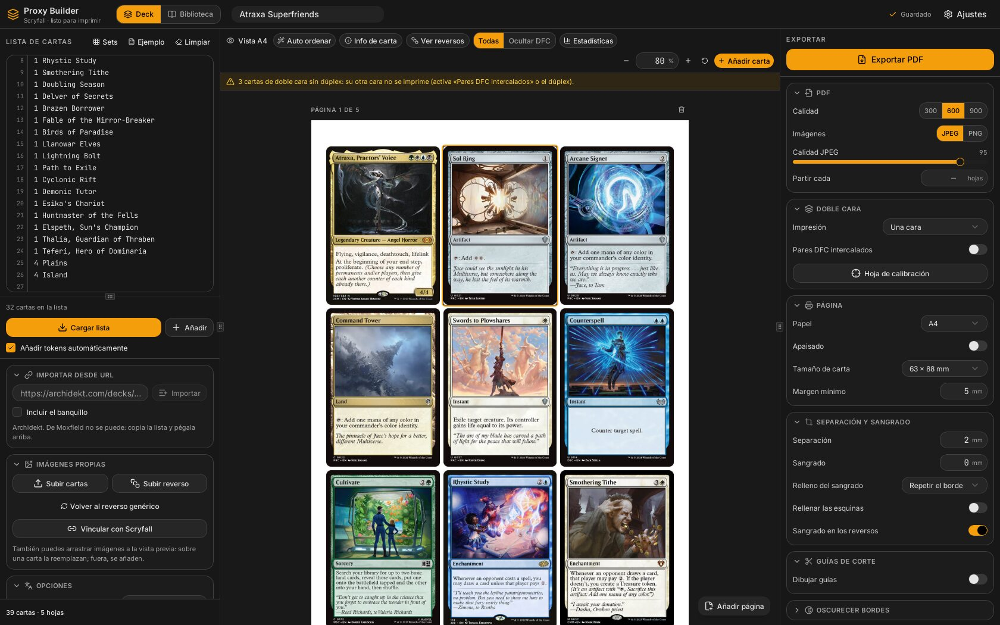

<!-- Vídeo de presentación: sustituir esta línea por el enlace o el reproductor. -->

---

## De la lista al papel en un minuto

1. **Pega la lista** como la tengas: `4 Lightning Bolt`, `1 Sol Ring (CMM) 410`…
   Vale el formato de Moxfield, Arena o MTGO, y la lista copiada como texto de
   Archidekt (con su cabecera `SIDEBOARD` o `#SIDEBOARD`). También se puede
   importar un deck de Archidekt por su URL, con banquillo o sin él.
2. **Pulsa «Cargar lista».** La app busca cada carta, elige la impresión,
   descarga las imágenes y, si quieres, añade sola las fichas que crea el deck.
3. **Revisa las hojas.** Lo que ves es lo que se imprime: la vista previa y el
   PDF salen del mismo cálculo, al milímetro.
4. **Exporta el PDF.** Imprime al 100 %, recorta y a jugar.

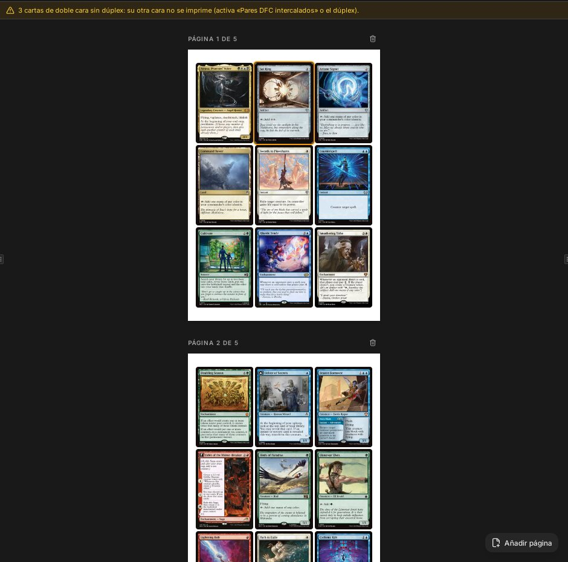

---

## Todo Scryfall a mano

**Cambiar de impresión.** Cada carta tiene todas sus ediciones a un clic, en
cualquier idioma, con opción de ver solo las de alta resolución. Puedes cambiar
una sola copia o todas a la vez.

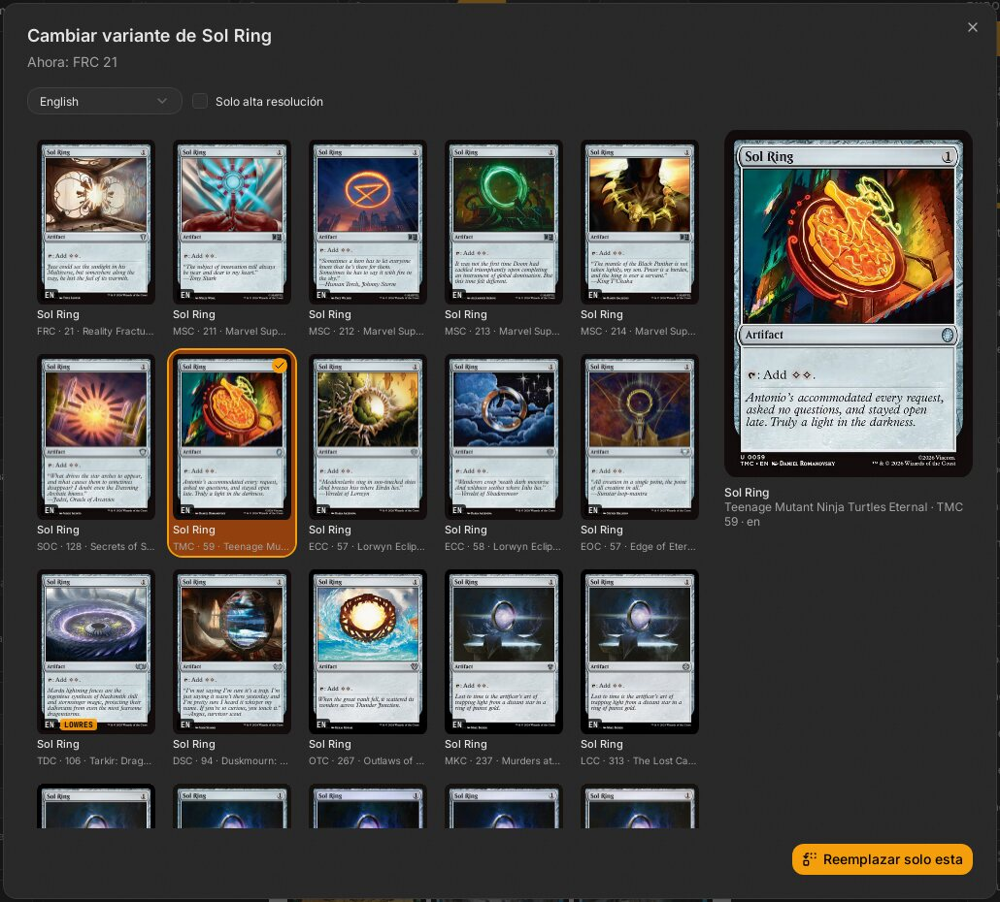

**Buscar y añadir cartas** por nombre (con autocompletado) o con la sintaxis de
Scryfall: `t:dragon c:r r:m` saca los dragones rojos míticos. Doble clic y
entra en el deck.

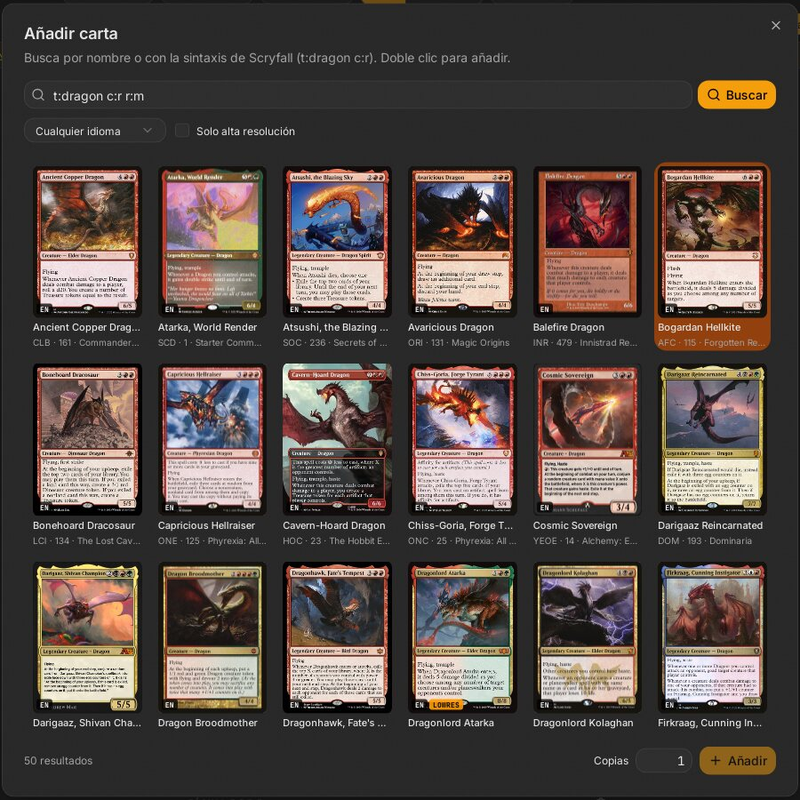

**Explorar sets enteros**, con todas sus cartas, y cargar las que elijas (o el
set completo) para sustituir la lista o añadirlas al final.

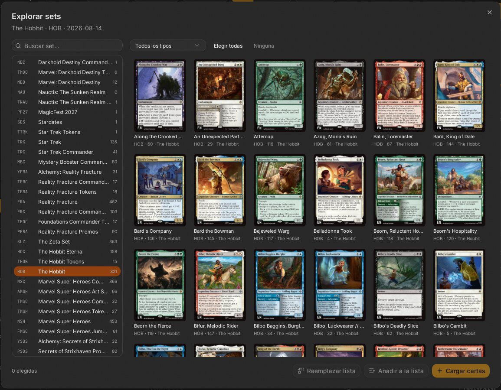

Y además:

- **Idioma de las cartas.** Elige en qué idioma quieres las impresiones; si una
  carta no existe en ese idioma, se queda en inglés y te avisa. «Reaplicar
  idioma» cambia de golpe todas las que no estén fijadas.
- **Fichas automáticas.** Las fichas, emblemas y copias que crean tus cartas se
  añaden solas al final. «Detectar fichas» busca las que le faltan a un deck ya
  hecho, también por las cartas propias vinculadas.
- **Más allá de Scryfall.** Las fichas que Scryfall no tiene (como Kelp o
  algunos Ooze) salen del catálogo de fichas de Cockatrice, en la lista, en
  «Añadir carta» y al vincular. También se encuentran las cartas escritas por
  su nombre en otro idioma que Scryfall no tiene impresas así; en *Ajustes* se
  puede descargar un índice de nombres en todos los idiomas para hacerlo sin
  preguntar en línea.
- **Avisos honestos**: carta no encontrada, imagen de baja resolución, carta que
  Scryfall aún no tiene escaneada… Cada casilla lo marca.

---

## Tus propias imágenes

- **Sube cartas propias** (alters, cartas hechas por ti, escaneos) o
  **arrástralas** a la vista previa: sobre una carta la reemplazan y fuera se
  añaden.
- **Reverso a tu gusto**: uno para todo el deck o uno distinto por carta.

### Vincular tus proxies con su carta real

Una imagen propia es solo una imagen: la app no sabe qué carta es. Al
vincularla con su carta de Scryfall, la imagen no cambia, pero la carta pasa a
contar en las estadísticas, en los precios y en la legalidad, y la info de
carta muestra su nombre y edición reales.

Aquí, un deck de proxies en español recién subido. Cada carta se llama como su
fichero y nada más:

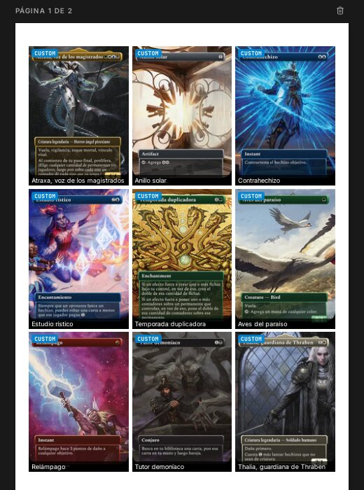

Para reconocerlas, la app lee cada imagen con **OCR**: el título, la línea de
tipo y el pie, donde muchos proxies llevan el nombre original. Busca lo leído
en el catálogo de Scryfall, en cualquier idioma, y propone la carta con un
grado de confianza: exacta, probable o sin propuesta. El nombre original se
encuentra esté donde esté (junto al artista, en una esquina, en la caja de
reglas), y también se leen la edición, el número y el idioma del pie, así que
queda apuntado el idioma de la imagen. La lectura se hace en tu equipo.

Se puede vincular de tres maneras:

**Una carta.** Clic derecho → «Vincular con una carta…». La búsqueda empieza
con el nombre del fichero y «Detectar con OCR» lee la carta. Aquí acierta
hasta la edición exacta.

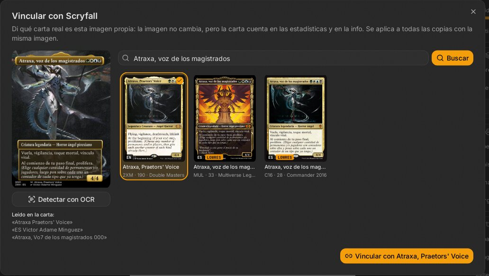

**Las seleccionadas.** Selecciona varias con Ctrl o Mayús y, con el clic
derecho, «Vincular las seleccionadas…». El diálogo deja elegir
entre la selección y todo el deck, y entre leer solo las que faltan o todas
otra vez.

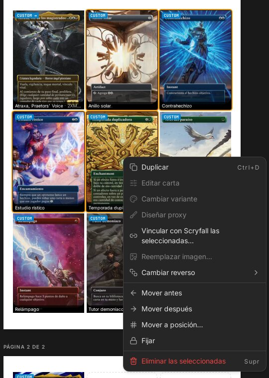

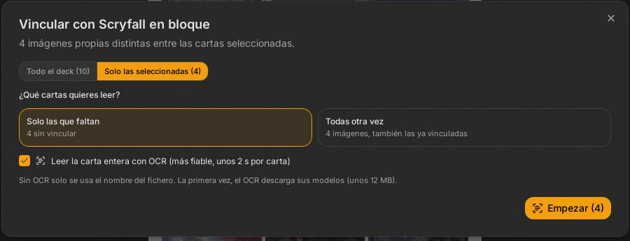

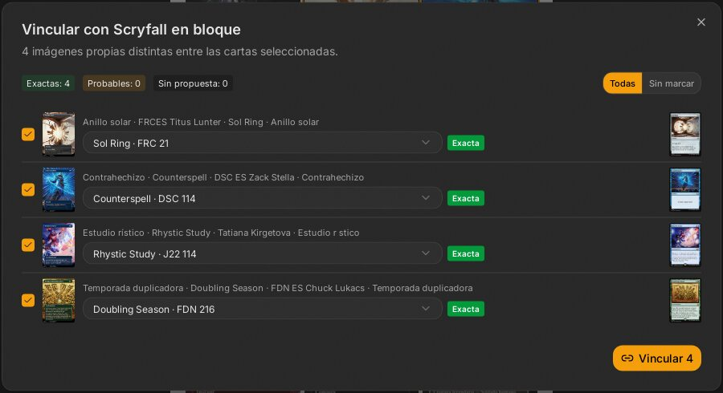

**Todo el deck.** El botón «Vincular con una carta» del panel izquierdo lee de
una vez todas las imágenes propias del deck, con barra de progreso y tiempo
restante, y se puede parar a medias para revisar lo leído. Cada propuesta se
puede cambiar en su desplegable o desmarcar antes de pulsar «Vincular». En este
deck también reconoce un proxy con arte inventado (Rimuru) por el nombre
original de su pie: Jodah, Archmage Eternal.

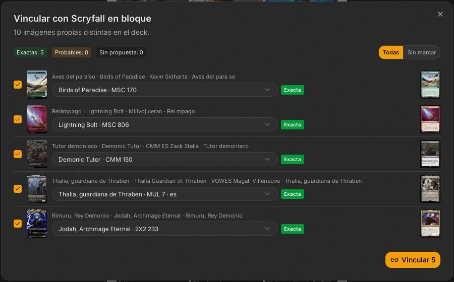

El resultado: las mismas imágenes, ahora con su carta real detrás.

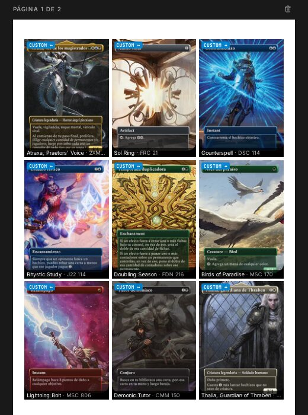

---

## Las hojas, como en una mesa de trabajo

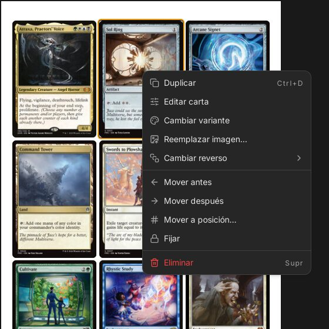

- **Arrastra** las cartas para reordenarlas, o usa «Mover antes / después / a
  la posición…». Selecciona varias con Ctrl o Mayús y actúa sobre todas.
- **Fija** una carta en su casilla para que nada la mueva.
- **Marca** una carta como **variante de diseño** (otra versión de una carta que
  ya está, para escoger una después), **opcional** o **banquillo**. Las marcadas
  se imprimen, pero no cuentan para el tamaño del mazo, el límite de copias ni
  las estadísticas: un Commander con variantes sigue sumando 100. Las de la
  sección Sideboard de la lista llegan ya marcadas.
- **Auto ordenar** junta las copias, quita los huecos y respeta las fijadas.
- **Info de carta** muestra el nombre y la edición de cada casilla; **Ver
  reversos** enseña la otra cara de la hoja.
- **Deshacer y rehacer** con Ctrl+Z y Ctrl+Mayús+Z (los últimos cien cambios).
- **Zoom** con Ctrl + rueda, y las hojas que no están a la vista no gastan
  memoria: decks de cientos de cartas se mueven con soltura.

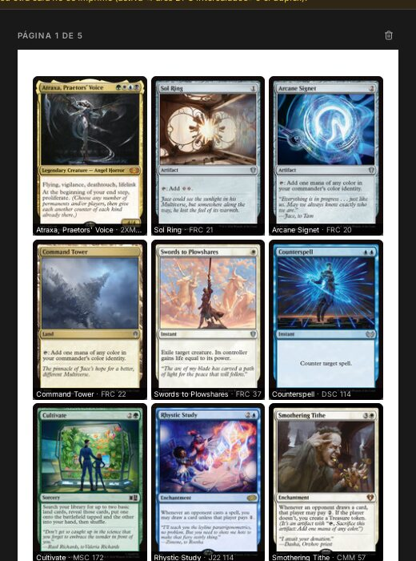

---

## Retoca cada carta

Giro, zoom, encuadre y **once ajustes de imagen**: brillo, exposición,
contraste, saturación, calidez, intensidad, nitidez, claridad, reducción de
ruido, viñeta y desvanecido. La vista se actualiza al instante y lo que ves es
el mismo render que irá al PDF.

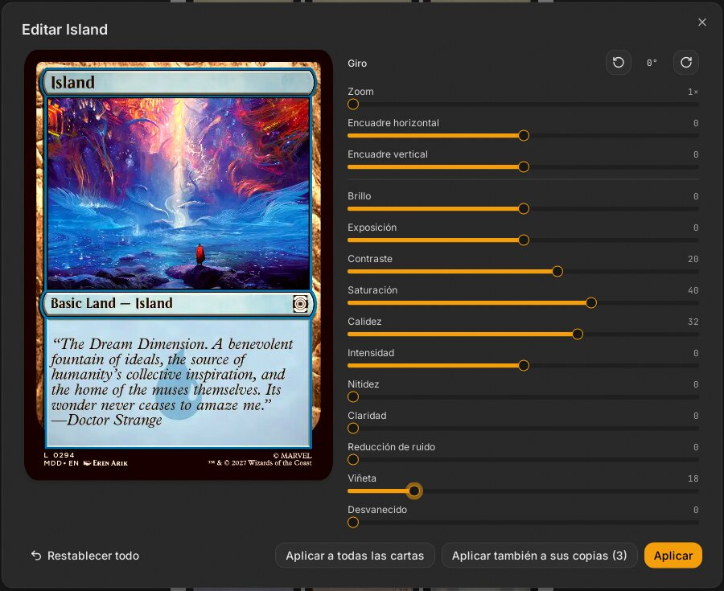

Cuando termines, decide a qué llega el cambio:

- **Aplicar**: solo a esta carta.
- **Aplicar también a sus copias**: a todas las que llevan la misma imagen, con
  giro, encuadre y retoques. Perfecto para las cuatro copias de una carta o
  para todas las tierras básicas del mismo arte.
- **Aplicar a todas las cartas**: los retoques de color a todo el deck (el giro
  y el encuadre se quedan en la carta).

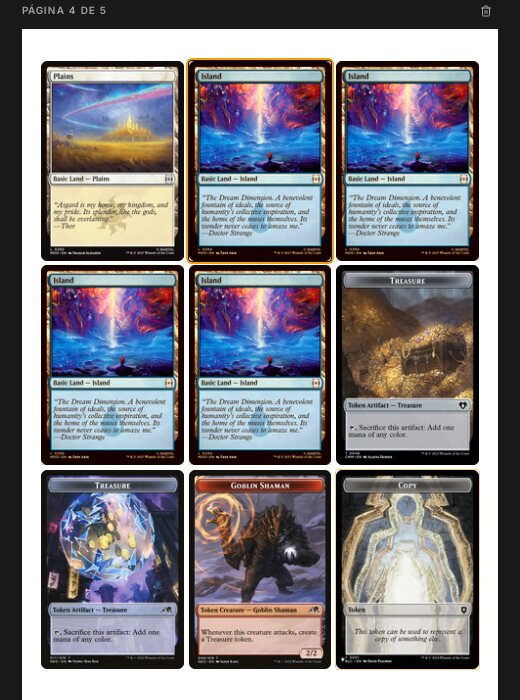

---

## Un PDF hecho para imprenta casera

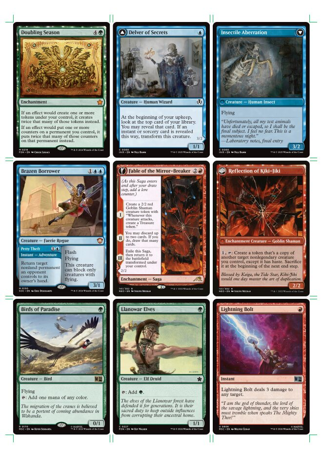

- **Calidad** a 300, 600 o 900 PPP, en JPEG (con calidad ajustable) o PNG.
- **Papeles**: A3, A4, A5, Letter, Legal, Tabloid y papel de foto (4×6″,
  5×7″, 8×10″, 8×12″), en vertical o apaisado.
- **Tamaño de carta** estándar de Magic (63 × 88 mm) o póquer
  (63,5 × 88,9 mm), con margen mínimo y separación entre cartas.
- **Sangrado** para que no quede filo blanco al cortar, repitiendo el borde o
  en espejo, también en los reversos.
- **Guías de corte** con el color, grosor y longitud que quieras.
- **Oscurecer bordes** claros de escaneos viejos (por contraste, negro sólido o
  umbral), sin tocar las cartas de borde blanco o arte completo.
- **Doble cara**: una cara, dúplex por el borde largo o por el corto.
  - La **hoja de calibración** dúplex y **«Alinear filas»** corrigen el
    desplazamiento de tu impresora fila a fila, midiendo con una regla.
- **Partir el PDF** cada N hojas.
  - Si el fichero va a ser enorme, la app avisa antes y propone bajar la
    calidad.
- **Presets**: guarda todos los ajustes de impresión con un nombre («Brother
  HL-L2350») y úsalos en cualquier deck.
- La exportación va con barra de progreso y se puede cancelar en cualquier
  momento.
- Los **⋮** junto a «Exportar PDF» copian la lista del deck para Moxfield,
  Arena, MTGO o en texto plano, la descargan para MTGO o guardan el deck con sus
  imágenes (`.pbdeck`).

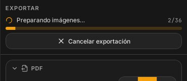

### Cartas de doble cara y cartas grandes

Las cartas de doble cara se imprimen con su reverso real en dúplex o, si tu
impresora es de una cara, como **pares intercalados**: las dos caras en
casillas seguidas, listas para meter en la misma funda. Las cartas grandes
(planos, planes, Vanguard) van en hojas propias al final, a su medida.

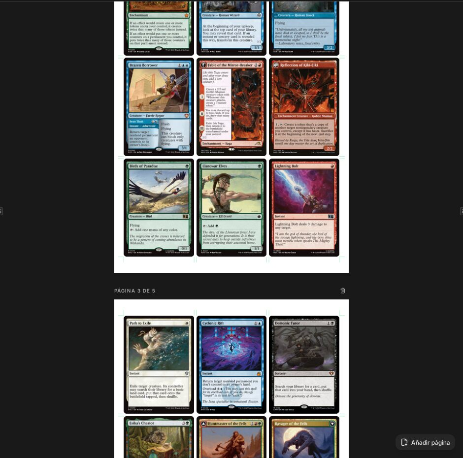

---

## Estadísticas del deck

Un panel completo con datos y precios de Scryfall:

- **Resumen**: cartas, tierras recomendadas, coste medio, precio estimado y
  probabilidad de una buena mano inicial.
- **Curva de maná** por tipo, colores, identidad de color y fichas que usa el
  deck.
- **Funciones**: rampa, robo, eliminación, barridos, contrahechizos, tutores,
  fichas… deducidas del texto de reglas de cada carta, con un botón para
  seleccionarlas en el deck.
- **Probabilidades**: calculadora de robo (hipergeométrica), tierras en la mano
  inicial y probabilidad de llegar a cada tierra por turno, empezando tú o el
  rival.
- **Precios** en euros (Cardmarket) o dólares (TCGplayer) de la impresión
  elegida, por tipo y de la más cara a la más barata.
- **Legalidad** por formato y bracket estimado de Commander. El formato se
  detecta solo o se elige a mano.

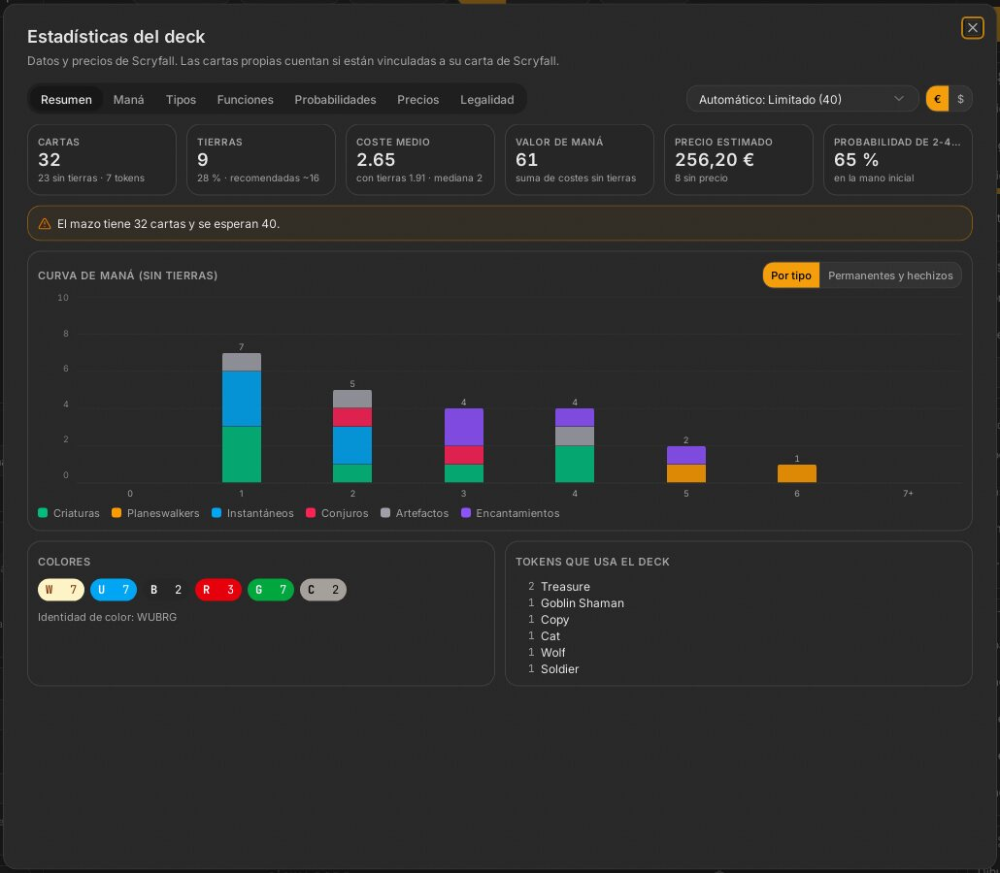

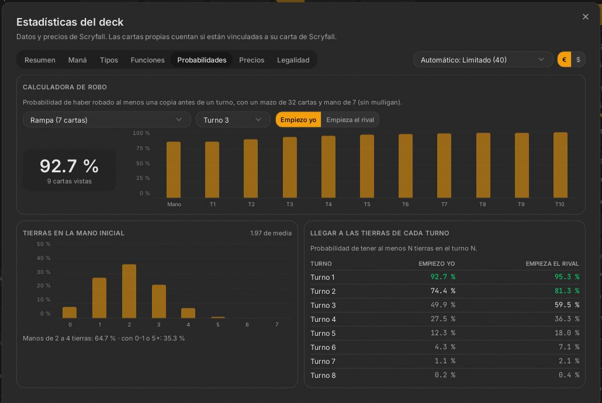

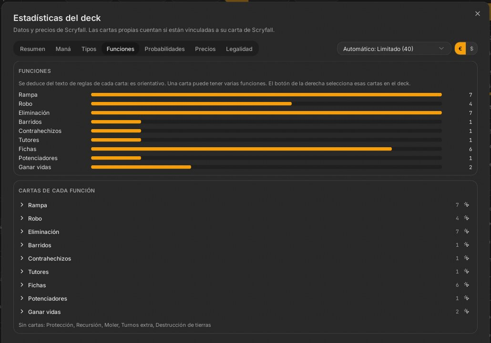

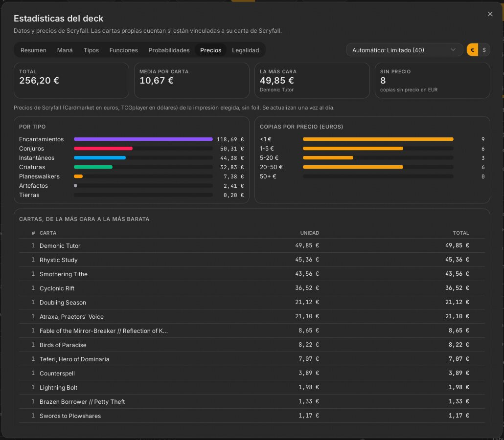

---

## Tu biblioteca de decks

Todos tus decks en un sitio, con su portada. Se **guardan solos** mientras
trabajas. Puedes duplicarlos, renombrarlos y **exportarlos como `.pbdeck`** con
todas sus imágenes dentro para pasarlos a otro equipo o a un amigo. «Liberar
espacio» borra las imágenes que ya no usa ningún deck.

- **Etiquetas tuyas**, con nombre y color: Commander, Por imprimir, Viernes de
  juego… Se ponen a un deck o a varios a la vez, y se filtra por una o por
  varias (los que tengan alguna o los que tengan todas).
- **Favoritos** arriba, **notas** en cada deck y la **portada** que elijas
  entre sus cartas.
- **Búsqueda** por el nombre del deck, por las cartas que lleva, por sus notas o
  por sus etiquetas. **Filtros** por identidad de color (los incluye, exactos o
  como mucho), por clase (Commander, construido, limitado), por los formatos en
  los que es legal, por el idioma de sus cartas y por si lleva cartas diseñadas
  o imágenes propias.
  Si un deck está de verdad en otro idioma pero sus cartas están vinculadas a
  impresiones en inglés, se le pone el **idioma a mano** desde su menú; de una
  imagen propia también se puede decir en qué idioma está.
- **Orden** por fecha de modificado, abierto o creado, nombre, cartas, precio,
  coste medio o colores, y **grupos** por etiqueta, colores, clase o idioma.
  Agrupados por etiqueta, un deck con varias sale en cada una.
- Dos vistas: la **cuadrícula**, en tres tamaños, y la **lista**, con los datos
  técnicos de cada deck: colores, clase y bracket, cartas y fichas, coste
  medio, precio estimado, idioma, imágenes propias y fechas.
- Varios decks a la vez (Ctrl + clic, Mayús + clic, Ctrl + A) para etiquetarlos,
  marcarlos como favoritos o borrarlos juntos.

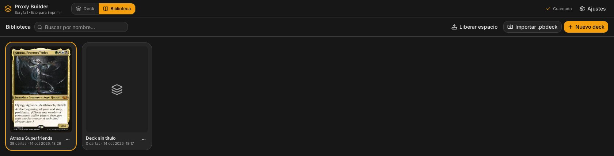

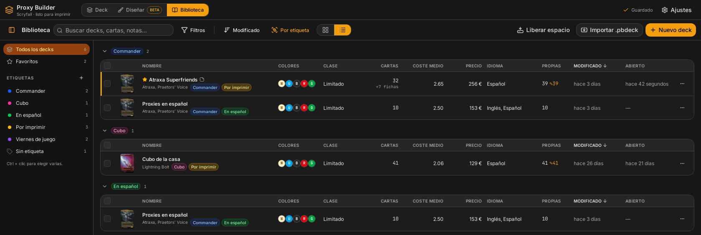

---

## A tu gusto

Español o inglés, tema claro u oscuro, más de cuarenta temas de color, tres estilos
de superficie (plano, relieve y cristal), materiales, efectos y tamaño de la
interfaz. «Más temas…» instala cualquier tema de la comunidad de
[tweakcn](https://tweakcn.com/community) por su enlace, con sus letras.

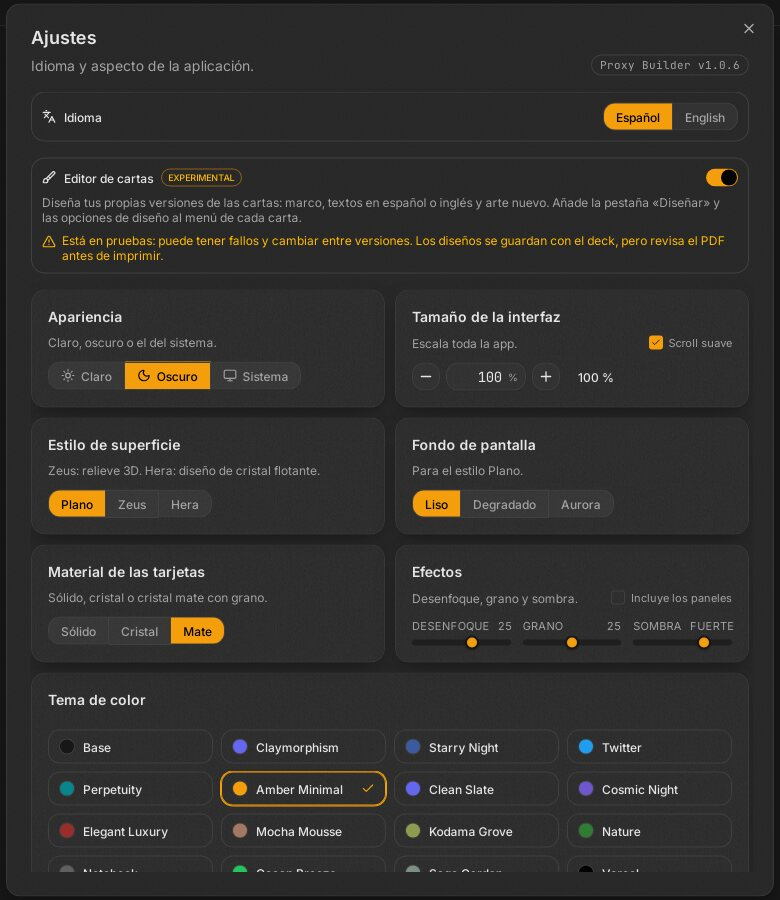

---

## Editor de cartas

La pestaña **Diseñar** y la opción «Diseñar proxy» del menú de cada carta
sirven para crear tu propia versión de una carta, con marco nuevo y los textos
traducidos:

- **Textos en español e inglés** sacados de la carta real, con la versión de
  cada idioma a un clic. Para las cartas sin impresión en español hay una
  traducción sugerida a partir de frases oficiales.
- **Arte** de Scryfall, subido, pegado o recortado de otra carta, con zoom,
  encuadre y giro.
- **Marcos y estilos** de un pack de marcos, con color, corona de legendaria
  y caja de reglas automáticos o a mano. Además del pack de la casa están los
  **marcos originales** de imagen (los M15 de Card Conjurer, normal y
  despejado), que se descargan la primera vez que se eligen.
- **Letras libres** para descargar desde la app: de aire clásico, medieval o
  de fantasía para el título (Cinzel, Almendra, Uncial Antiqua, Grenze
  Gotisch…) y muy legibles para las reglas, además de una pixelada (Pixelify
  Sans). La colección decide cuánto se estrechan el título y el tipo, siempre
  y como mucho.
- **Packs de marcos para descargar.** El primero es **Balatro**: marcos de
  pixel art en siete estilos (Joker, Planeswalker, Espectral, Tarot, Planeta,
  Vale y Tierra), con sus fichas de maná, etiquetas de rareza y palabras de
  colores, y reversos, fichas y tierras ya hechos para añadir al deck.
- **Colecciones** con su símbolo y numeración, para que todo el deck parezca de
  la misma edición.
- Casi todas las maquetaciones de Magic: planeswalkers, sagas, clases, casos,
  niveles, aventuras, cartas partidas, flip, doble cara, batallas, meld,
  mazmorras y cartas grandes.
- **Diseñar el deck** entero de una vez (un borrador por carta, que luego se
  revisa) y **exportar imágenes** PNG a 300, 600 o 900 PPP, en carpetas `es/` y
  `en/`.

Las cartas diseñadas se imprimen en el PDF desde el diseño, a la resolución de
exportación.

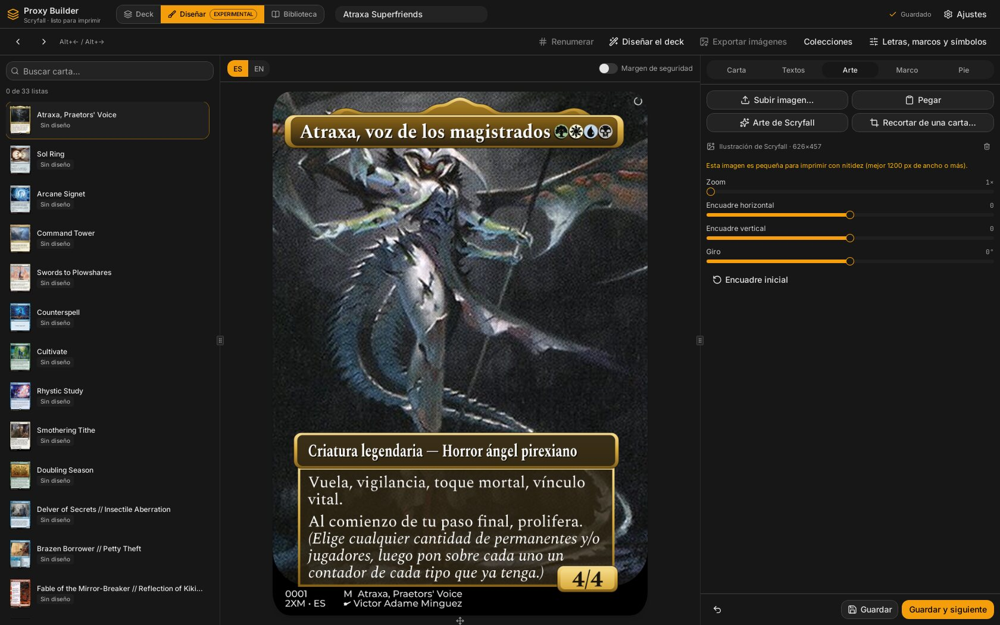

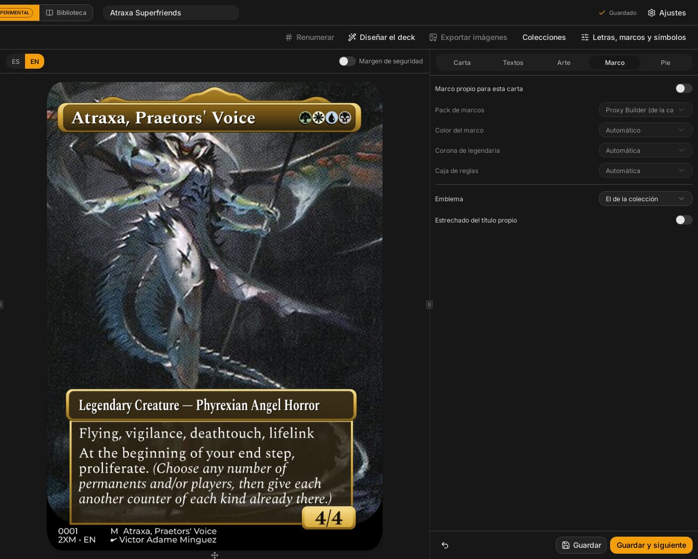

---

## Por dentro

- **Aplicación nativa** hecha con Tauri y Rust: todo lo pesado (búsquedas,
  descargas, imágenes, PDF, estadísticas) va en Rust y aprovecha todos los
  núcleos.
- **Local y privada.** Tus decks y tus imágenes se quedan en tu equipo. La única
  conexión es a Scryfall, para cartas, imágenes y precios, y lo ya descargado
  queda en caché.
- **Exacta al milímetro.** La vista previa y el PDF usan la misma geometría,
  así que lo que ves en pantalla es lo que sale de la impresora.

---

## Descargar

Los instaladores de cada versión están en la página de *Releases* del
repositorio. No van firmados: Windows (SmartScreen) avisará de «editor
desconocido» (Más información → Ejecutar de todas formas) y macOS (Gatekeeper)
pedirá abrir la app con clic derecho → Abrir la primera vez.

Desde ahí la app se actualiza sola: al abrirla (y cada pocas horas) busca una
versión nueva, la baja sin molestar y ofrece reiniciar. Se puede apagar, o
buscar a mano, en Ajustes → Actualizaciones. Cada actualización va firmada y la
app la comprueba antes de instalarla; en Linux, el `.deb` y el `.rpm` piden tu
contraseña para instalarla. Las versiones anteriores a la 2.4.0 aún no lo
tienen: instala la 2.4.0 a mano una vez.

Los datos viven en la carpeta de datos de la app (`com.estigio.proxybuilder`):
la biblioteca (`library.db`), las imágenes de los decks (`blobs/`) y el
registro (`logs/proxy-builder.log`). La caché de miniaturas se puede borrar
desde la app sin perder nada.

---

## Para desarrollar

Tauri 2 + Rust + React/TypeScript.

### Requisitos

- Node 22 y pnpm 12 o superior.
- Rust estable (1.92 o superior).
- En Linux, las librerías de Tauri:
  `sudo apt install libwebkit2gtk-4.1-dev build-essential curl wget file libxdo-dev libssl-dev libayatana-appindicator3-dev librsvg2-dev`

### Arrancar

```bash
pnpm install
pnpm tauri dev
```

La primera compilación de Rust tarda varios minutos.

### Comprobar

```bash
pnpm check            # TypeScript, tests, Biome, textos y Knip
pnpm check:clippy     # avisos de Rust (bloqueantes)
pnpm test:rust        # tests de Rust
```

### Instaladores

`pnpm tauri build` genera los de la plataforma en la que se ejecuta. El
workflow `.github/workflows/release.yml` genera los de Linux, Windows y macOS
(Intel y Apple Silicon) en un borrador de release. Para sacar una versión:
`pnpm release patch` (o `minor`, `major`, `X.Y.Z`; con `--dry` solo comprueba).
Sube la versión en los cuatro sitios, la commitea y la sube, espera a la CI,
lanza el workflow a mano (pestaña Actions → release) y, al terminar, pregunta si
publicar el borrador. Al publicarlo se crea la etiqueta. Necesita `gh` con la
sesión iniciada.

Los instaladores van firmados para el actualizador de la app (no para
SmartScreen ni Gatekeeper) con la clave del secreto `TAURI_SIGNING_PRIVATE_KEY`
del repositorio; su mitad pública está en `tauri.conf.json`. El borrador lleva
un `latest.json` con una entrada por instalador, y las apps instaladas lo ven al
publicarlo. Si se pierde la clave privada, las versiones instaladas no aceptarán
ninguna actualización nueva.

---

## Créditos

Los datos y las imágenes de las cartas vienen de [Scryfall](https://scryfall.com).
Los marcos originales del editor vienen de
[Card Conjurer](https://github.com/Investigamer/cardconjurer): la app los
descarga al usarlos y no los distribuye.
Las plantillas del pack Balatro son del autor del mazo «Balatro Balatrez», que
las comparte públicamente; su letra es m6x11plus, de Daniel Linssen. Balatro es
un juego de LocalThunk. Las fichas que no están en Scryfall vienen de
[Cockatrice](https://github.com/Cockatrice/Magic-Token), los nombres en otros
idiomas de [MTGJSON](https://mtgjson.com) y
[magicthegathering.io](https://magicthegathering.io), y los temas de color de
más de [tweakcn](https://tweakcn.com).
Magic: The Gathering es una marca de Wizards of the Coast. Esta aplicación no está
afiliada ni respaldada por ninguna de las dos.
