# Proxy Builder

[**Español**](README.es.md) · **English**

**Paste your Magic list and get a PDF ready to print, cut out and play.**

Proxy Builder is a desktop app for building *Magic: The Gathering* proxy decks.
It looks up each card on Scryfall, downloads the best image, places it on sheets
at real size and generates a PDF with bleed, cut guides and well-aligned double
faces. All the work is done on your computer, fast, with no accounts and no ads.

For Linux, Windows and macOS, in Spanish and in English.

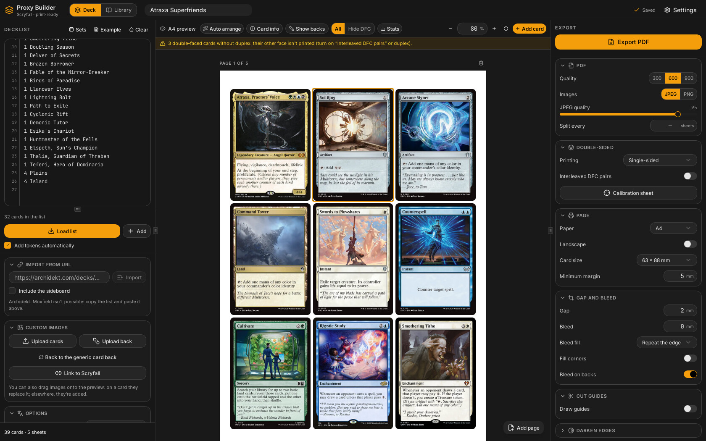

<!-- Vídeo de presentación: sustituir esta línea por el enlace o el reproductor. -->

---

## From list to paper in a minute

1. **Paste the list** however you have it: `4 Lightning Bolt`, `1 Sol Ring (CMM) 410`…
   The Moxfield, Arena or MTGO formats work, and so does a list copied as text from
   Archidekt (with its `SIDEBOARD` or `#SIDEBOARD` header). You can also import an
   Archidekt deck by its URL, with or without the sideboard.
2. **Press «Cargar lista» (Load list).** The app looks up each card, picks the
   printing, downloads the images and, if you want, automatically adds the tokens
   the deck creates.
3. **Check the sheets.** What you see is what gets printed: the preview and the
   PDF come from the same calculation, down to the millimetre.
4. **Export the PDF.** Print at 100 %, cut and play.

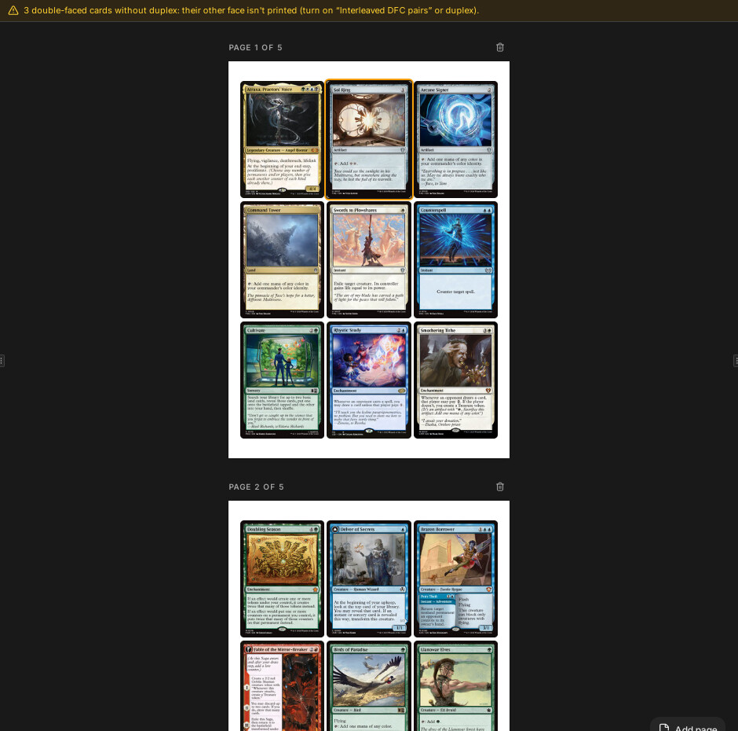

---

## All of Scryfall, by hand

**Change the printing.** Every card has all its editions one click away, in any
language, with the option to show only the high-resolution ones. You can change
a single copy or all of them at once.

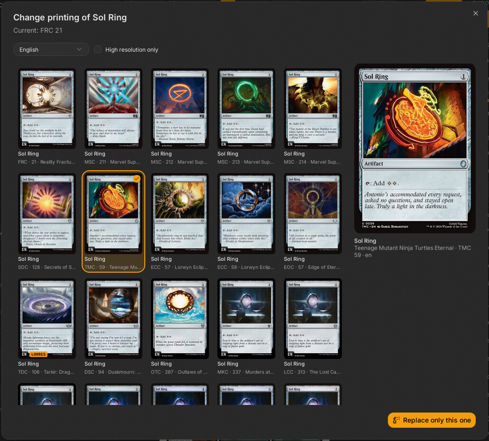

**Search and add cards** by name (with autocomplete) or with Scryfall syntax:
`t:dragon c:r r:m` finds the red mythic dragons. Double-click and it goes into
the deck.

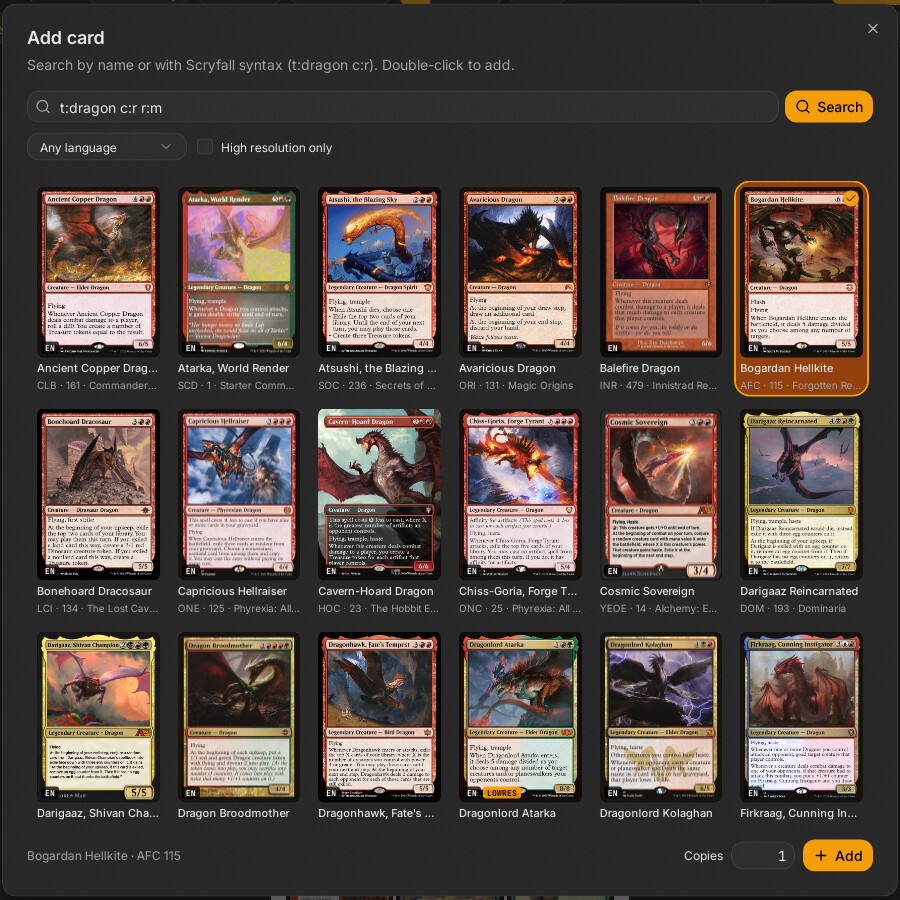

**Browse entire sets**, with all their cards, and load the ones you choose (or
the whole set) to replace the list or add them to the end.

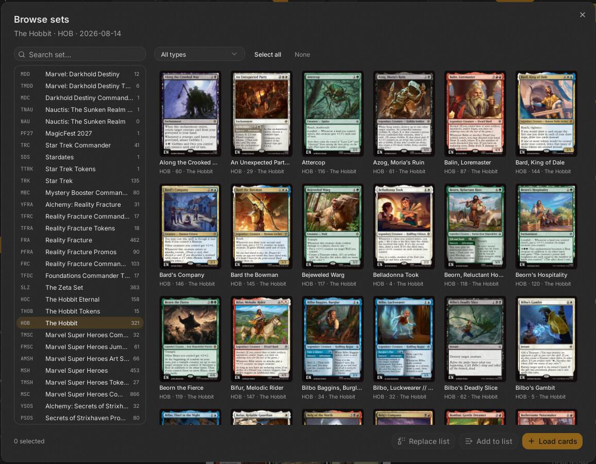

And also:

- **Card language.** Choose which language you want the printings in; if a card
  doesn't exist in that language, it stays in English and tells you. «Reaplicar
  idioma» (Reapply language) changes all the cards that aren't pinned at once.
- **Automatic tokens.** The tokens, emblems and copies your cards create are
  added to the end automatically. «Detectar fichas» (Detect tokens) looks for the
  ones an existing deck is missing, also for linked custom cards.
- **Beyond Scryfall.** Tokens Scryfall doesn't have (such as Kelp or some Oozes)
  come from the Cockatrice token catalogue, in the list, in «Añadir carta» (Add
  card) and when linking. Cards written by their name in another language that
  Scryfall doesn't have printed that way are found too; in *Settings* you can
  download an index of names in every language to do it without asking online.
- **Honest warnings**: card not found, low-resolution image, card Scryfall
  doesn't have scanned yet… Each slot marks it.

---

## Your own images

- **Upload custom cards** (alters, cards you made, scans) or **drag them** onto
  the preview: over a card they replace it, outside they are added.
- **Back to your taste**: one for the whole deck or a different one per card.

### Linking your proxies to their real card

A custom image is just an image: the app doesn't know which card it is. When you
link it to its Scryfall card, the image doesn't change, but the card starts
counting in the statistics, the prices and the legality, and the card info shows
its real name and edition.

Here, a freshly uploaded deck of Spanish proxies. Each card is named like its
file and nothing more:

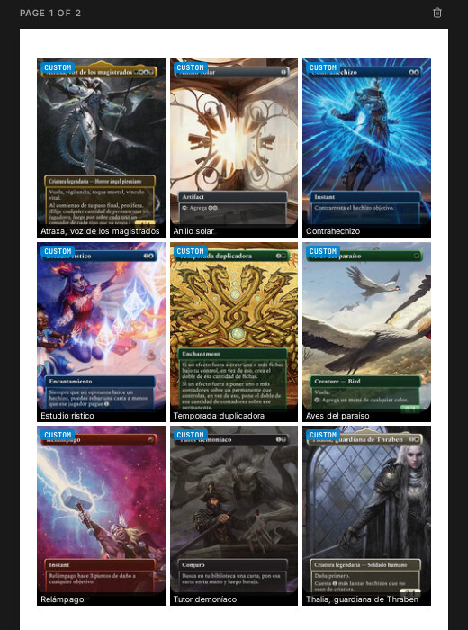

To recognise them, the app reads each image with **OCR**: the title, the type
line and the bottom text, where many proxies carry the original name. It searches
what it reads in the Scryfall catalogue, in any language, and proposes the card
with a confidence level: exact, probable or no proposal. The original name is
found wherever it is (next to the artist, in a corner, in the rules box), and the
set, number and language printed at the bottom are read too, so the image's
language is noted. The reading is done on your computer.

You can link in three ways:

**One card.** Right click → «Vincular con una carta…» (Link to a card…). The
search starts with the file name and «Detectar con OCR» (Detect with OCR) reads
the card. Here it gets the exact edition right.

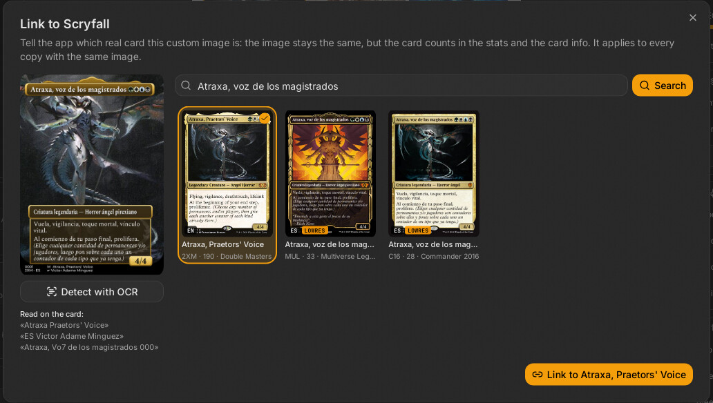

**The selected ones.** Select several with Ctrl or Shift and, with the right
click, «Vincular las seleccionadas…» (Link selected…). The dialog lets you choose between the selection and the whole deck,
and between reading only the missing ones or all of them again.

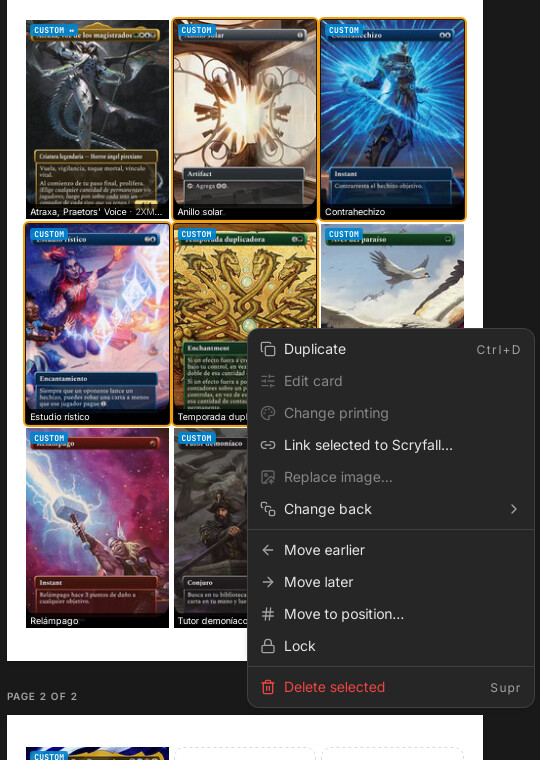

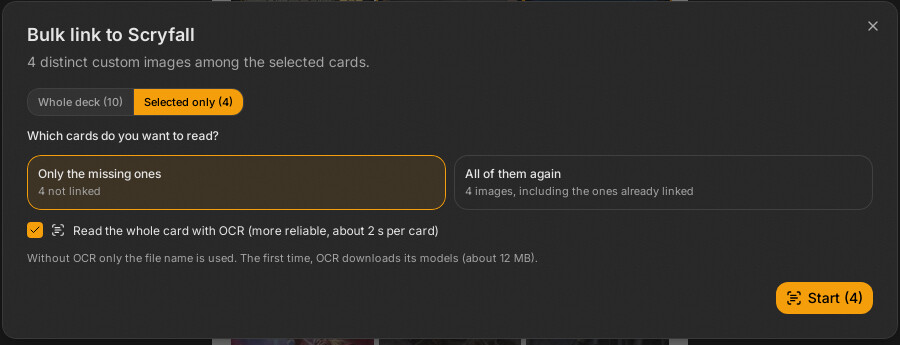

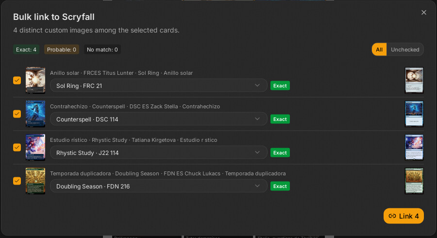

**The whole deck.** The «Vincular con una carta» (Link to a card) button in the
left panel reads all the deck's custom images in one go, with a progress bar and
time remaining, and you can stop halfway to review what was read. Each proposal
can be changed in its dropdown or unticked before pressing «Vincular» (Link).
In this deck it also recognises a proxy with invented art (Rimuru) by its
original name at the bottom: Jodah, Archmage Eternal.

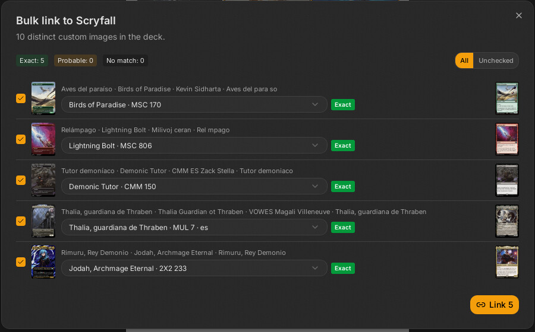

The result: the same images, now with their real card behind them.

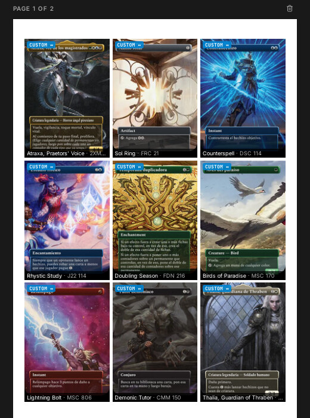

---

## Sheets, as on a workbench

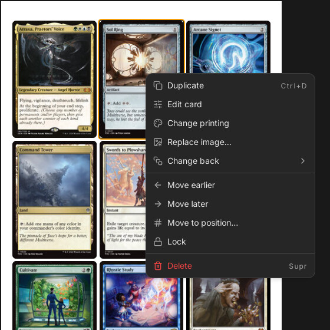

- **Drag** cards to reorder them, or use «Mover antes / después / a la posición…»
  (Move before / after / to position…). Select several with Ctrl or Shift and act
  on all of them.
- **Pin** a card to its slot so nothing moves it.
- **Auto sort** groups the copies, removes the gaps and respects the pinned cards.
- **Card info** shows the name and edition of each slot; **Ver reversos** (Show
  backs) shows the other side of the sheet.
- **Undo and redo** with Ctrl+Z and Ctrl+Shift+Z (the last hundred changes).
- **Zoom** with Ctrl + wheel, and the sheets that are out of view don't use up
  memory: decks of hundreds of cards move smoothly.

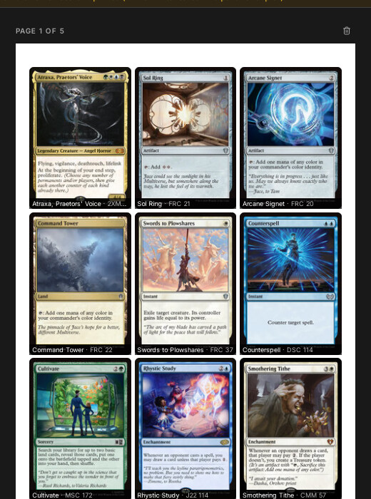

---

## Retouch each card

Rotation, zoom, framing and **eleven image adjustments**: brightness, exposure,
contrast, saturation, warmth, intensity, sharpness, clarity, noise reduction,
vignette and fade. The view updates instantly and what you see is the same render
that will go into the PDF.

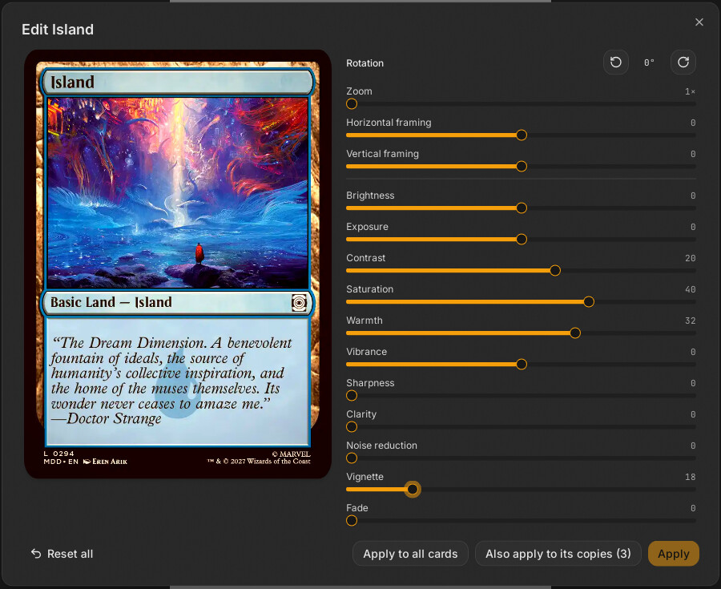

When you're done, decide where the change goes:

- **Apply**: only to this card.
- **Apply also to its copies**: to all the ones that use the same image, with
  rotation, framing and adjustments. Perfect for the four copies of a card or for
  all the basic lands with the same art.
- **Apply to all cards**: the colour adjustments to the whole deck (rotation and
  framing stay on the card).

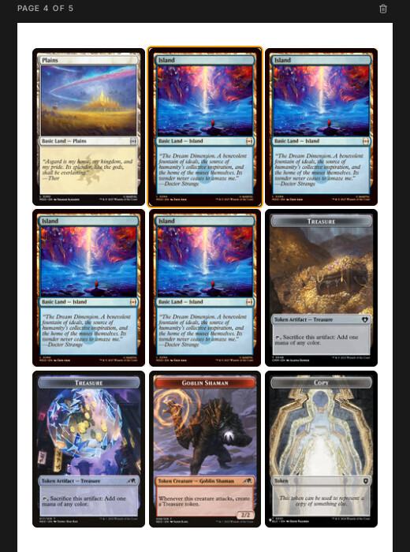

---

## A PDF made for home printing


- **Quality** at 300, 600 or 900 DPI, in JPEG (with adjustable quality) or PNG.
- **Paper**: A3, A4, A5, Letter, Legal, Tabloid and photo paper (4×6″, 5×7″,
  8×10″, 8×12″), portrait or landscape.
- **Standard Magic card size** (63 × 88 mm) or poker size (63.5 × 88.9 mm), with
  minimal margin and spacing between cards.
- **Bleed** so there is no white edge when cutting, repeating the border or
  mirrored, also on the backs.
- **Cut guides** with the colour, thickness and length you want.
- **Darken edges**: light borders from old scans (by contrast, solid black or
  threshold), without touching white-border cards or full-art cards.
- **Double-sided**: one side, duplex along the long edge or the short edge.
  - The duplex **calibration sheet** and **«Alinear filas»** (Align rows) correct
    your printer's offset row by row, measuring with a ruler.
- **Split the PDF** every N sheets.
  - If the file is going to be huge, the app warns you first and suggests lowering
    the quality.
- **Presets**: save all your print settings under a name («Brother HL-L2350») and
  use them in any deck.
- Exporting shows a progress bar and can be cancelled at any moment.

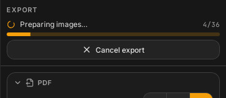

### Double-faced cards and large cards

Double-faced cards are printed with their real back, duplex or, if your printer
is single-sided, as **interleaved pairs**: both faces in consecutive slots, ready
to go in the same sleeve. Large cards (planes, schemes, Vanguard) go on their own
sheets at the end, at their size.

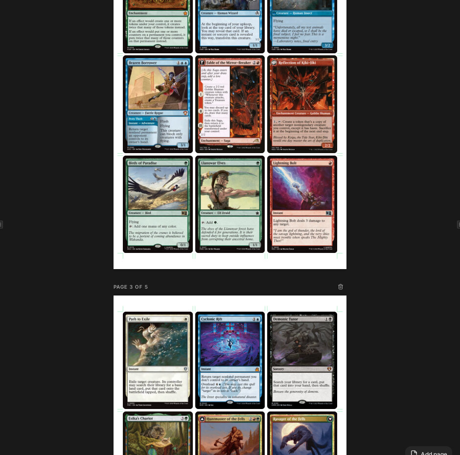

---

## Deck statistics

A full panel with data and prices from Scryfall:

- **Summary**: cards, recommended lands, average cost, estimated price and the
  probability of a good opening hand.
- **Mana curve** by type, colours, colour identity and the tokens the deck uses.
- **Functions**: ramp, card draw, removal, sweepers, counterspells, tutors,
  tokens… deduced from each card's rules text, with a button to select them in the
  deck.
- **Probabilities**: draw calculator (hypergeometric), lands in the opening hand
  and the probability of reaching each land drop, going first or second.
- **Prices** in euros (Cardmarket) or dollars (TCGplayer) for the chosen printing,
  by type and from most to least expensive.
- **Legality** by format and estimated Commander bracket. The format is detected
  automatically or chosen by hand.

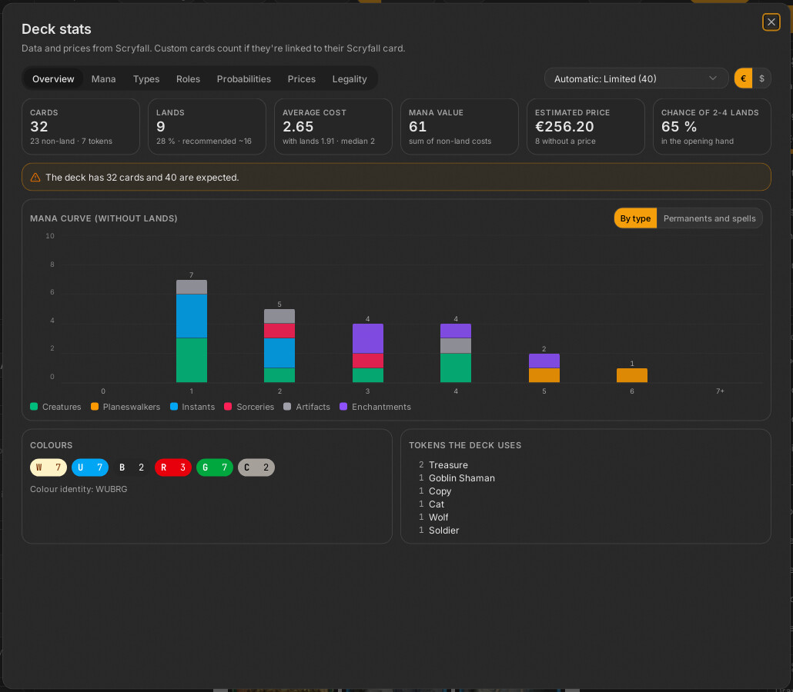

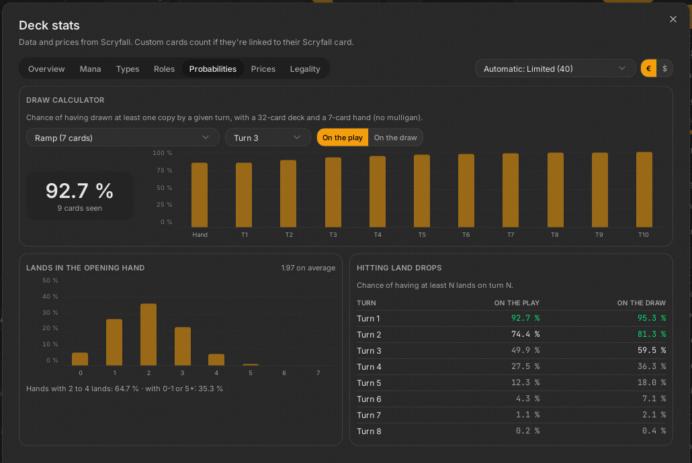

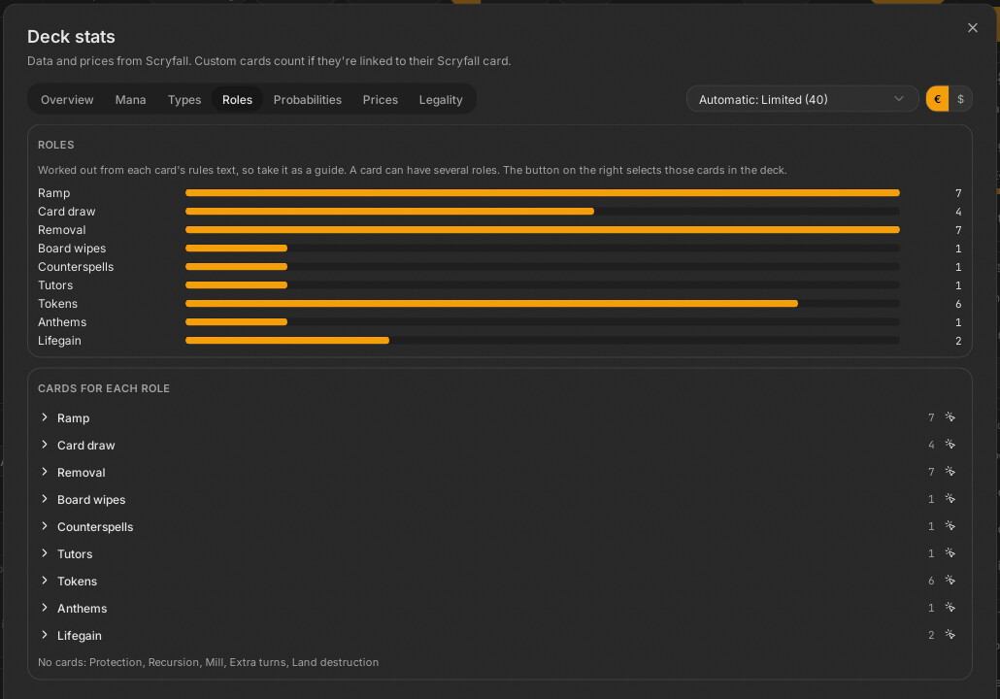

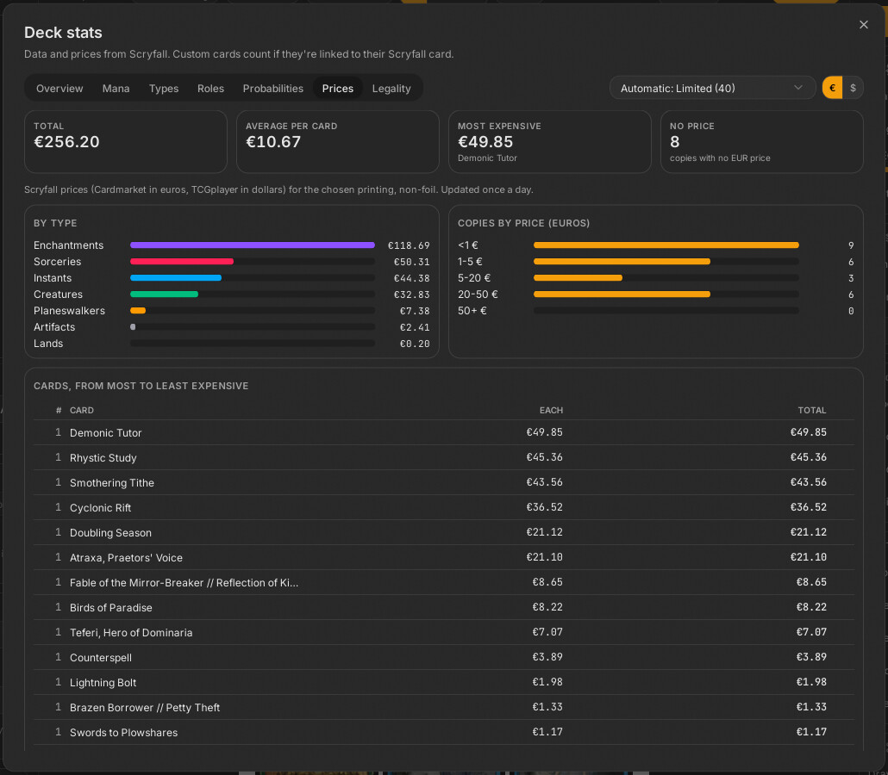

---

## Your deck library

All your decks in one place, with their cover. They **save automatically** while
you work. You can duplicate them, rename them and **export them as `.pbdeck`** with
all their images inside to pass them to another computer or a friend. «Liberar
espacio» (Free up space) deletes the images that no deck uses any more.

- **Your own tags**, with a name and a colour: Commander, To print, Friday
  night… Put them on one deck or on several at once, and filter by one or by
  several (decks with any of them, or with all of them).
- **Favourites** at the top, **notes** for each deck and the **cover** you pick
  from its cards.
- **Search** by deck name, by the cards it has, by its notes or by its tags.
  **Filters** by colour identity (includes, exactly or at most), by class
  (Commander, constructed, limited), by the formats it's legal in, by the
  language of its cards, and by whether it has designed cards or custom images.
  If a deck is really in another language but its cards are linked to English
  printings, set its **language by hand** from its menu; for a custom image you
  can also say which language it is in.
- **Sort** by modified, opened or created date, name, cards, price, average cost
  or colours, and **group** by tag, colours, class or language. Grouped by tag, a
  deck with several tags shows up under each one.
- Two views: the **grid**, in three sizes, and the **list**, with the technical
  details of each deck: colours, class and bracket, cards and tokens, average
  cost, estimated price, language, custom images and dates.
- Select several decks (Ctrl + click, Shift + click, Ctrl + A) to tag them, mark
  them as favourites or delete them together.

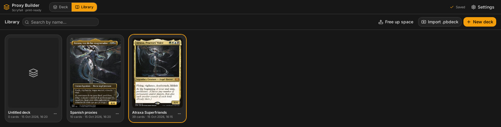

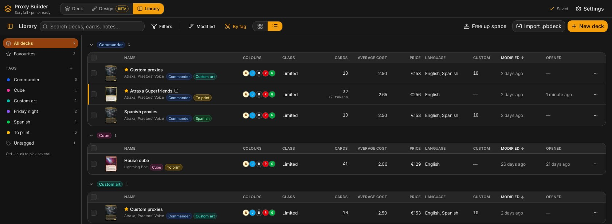

---

## To your taste

Spanish or English, light or dark theme, more than forty colour themes, three
surface styles (flat, embossed and glass), materials, effects and interface size.
«Más temas…» (More themes…) installs any theme from the
[tweakcn](https://tweakcn.com/community) community by its link, with its fonts.

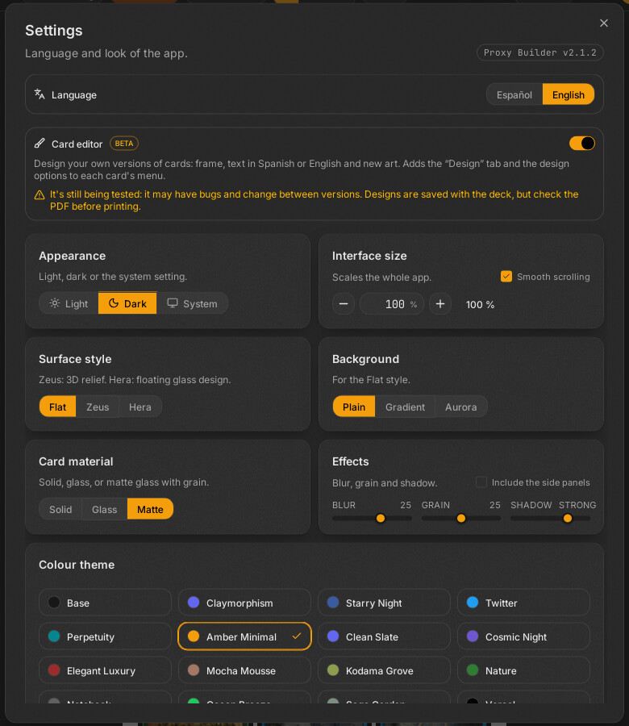

---

## Card editor (beta)

> It comes **turned off**. Turn it on in *Settings → Card editor*. It is still
> being tested: it may have bugs and change between versions.

When turned on, the **Design** tab appears, along with the «Diseñar proxy»
(Design proxy) option in each card's menu. It lets you create your own version of
a card, with a new frame and translated text:

- **Text in Spanish and English** taken from the real card, with each language's
  version one click away. For cards with no Spanish printing there is a suggested
  translation based on official phrases.
- **Art** from Scryfall, uploaded, pasted or cropped from another card, with zoom,
  framing and rotation.
- **Frames and styles** from a frame pack, with colour, legendary crown and rules
  box automatic or manual. Besides the house pack there are the **original image
  frames** (the Card Conjurer M15s, normal and borderless), which are downloaded
  the first time they are chosen.
- **Free fonts** to download from the app: classical, medieval or fantasy style
  for the title (Cinzel, Almendra, Uncial Antiqua, Grenze Gotisch…) and very
  legible ones for the rules text, plus a pixel font (Pixelify Sans). In
  addition, the collection decides how much the title and the type line are
  condensed, always and at most.
- **Downloadable frame packs.** The first one is **Balatro**: pixel-art frames
  in seven styles (Joker, Planeswalker, Spectral, Tarot, Planet, Voucher and
  Land), with their mana chips, rarity labels and coloured keywords, plus
  ready-made backs, tokens and lands to add to the deck.
- **Collections** with their set symbol and numbering, so the whole deck looks like
  it's from the same edition.
- Almost all of Magic's layouts: planeswalkers, sagas, classes, cases, levels,
  adventures, split cards, flip, double-faced, battles, meld, dungeons and large
  cards.
- **Design the whole deck** at once (a draft per card, to be reviewed afterwards)
  and **export PNG images** at 300, 600 or 900 DPI, into `es/` and `en/` folders.

Designed cards are printed to the PDF from their design, at the export resolution.

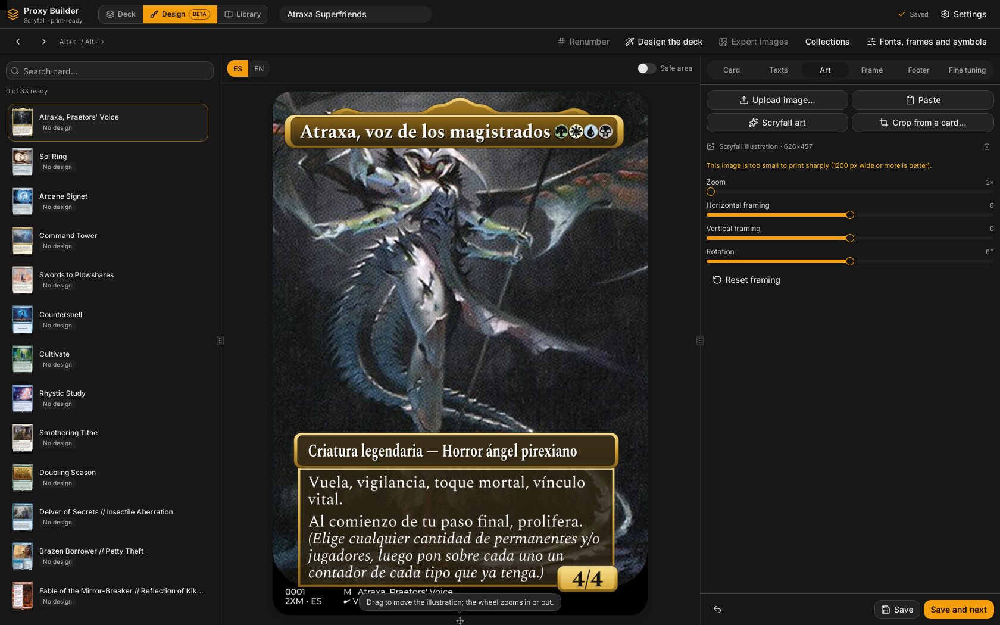

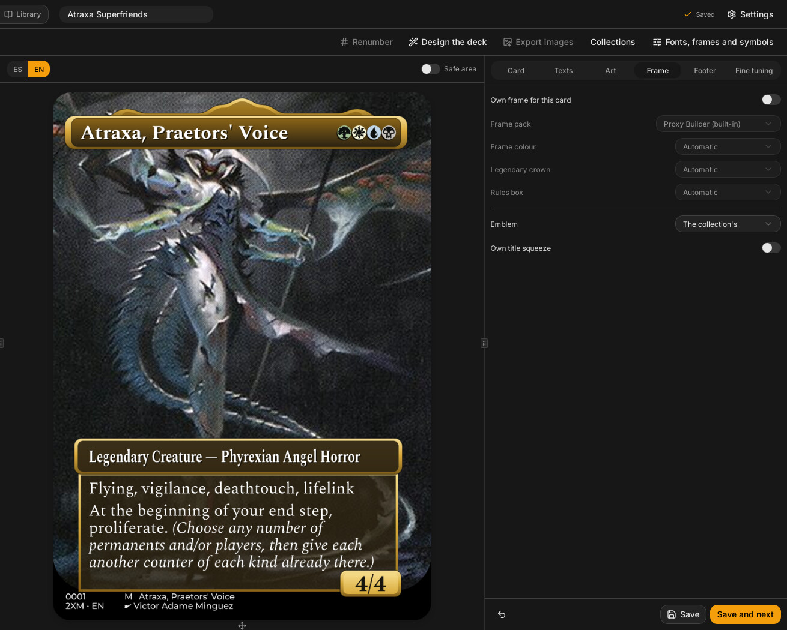

---

## Under the hood

- **Native application** built with Tauri and Rust: everything heavy (searches,
  downloads, images, PDF, statistics) runs in Rust and uses all the cores.
- **Local and private.** Your decks and images stay on your computer. The only
  connection is to Scryfall, for cards, images and prices, and what has already
  been downloaded is cached.
- **Exact to the millimetre.** The preview and the PDF use the same geometry, so
  what you see on screen is what comes out of the printer.

---

## Download

The installers for each version are on the *Releases* page of the repository.
They are not signed: Windows (SmartScreen) will warn about an «unknown publisher»
(More info → Run anyway) and macOS (Gatekeeper) will ask you to open the app with
right click → Open the first time.

The data lives in the app's data folder (`com.estigio.proxybuilder`): the library
(`library.db`), the deck images (`blobs/`) and the log (`logs/proxy-builder.log`).
The thumbnail cache can be cleared from the app without losing anything.

---

## For developers

Tauri 2 + Rust + React/TypeScript.

### Requirements

- Node 22 and pnpm 12 or later.
- Stable Rust (1.92 or later).
- On Linux, the Tauri libraries:
  `sudo apt install libwebkit2gtk-4.1-dev build-essential curl wget file libxdo-dev libssl-dev libayatana-appindicator3-dev librsvg2-dev`

### Run

```bash
pnpm install
pnpm tauri dev
```

The first Rust build takes several minutes.

### Check

```bash
pnpm check            # TypeScript, tests, Biome, texts and Knip
pnpm check:clippy     # Rust warnings (blocking)
pnpm test:rust        # Rust tests
```

### Installers

`pnpm tauri build` produces the installers for the platform it runs on. The
workflow `.github/workflows/release.yml` produces the ones for Linux, Windows and
macOS (Intel and Apple Silicon) in a release draft. To ship a version:
`pnpm release patch` (or `minor`, `major`, `X.Y.Z`; with `--dry` it only checks).
It bumps the version in four places, commits and pushes it, waits for the CI,
starts the workflow by hand (Actions tab → release) and, when it finishes, asks
whether to publish the draft. Publishing creates the tag. It needs `gh` with an
active session.

---

## Credits

The card data and images come from [Scryfall](https://scryfall.com).
The editor's original frames come from
[Card Conjurer](https://github.com/Investigamer/cardconjurer): the app downloads
them when they are used and does not distribute them.
The Balatro pack's templates are by the author of the «Balatro Balatrez» deck,
who shares them publicly; its font is m6x11plus by Daniel Linssen. Balatro is a
game by LocalThunk. Token data not in Scryfall comes from
[Cockatrice](https://github.com/Cockatrice/Magic-Token), names in other
languages from [MTGJSON](https://mtgjson.com) and
[magicthegathering.io](https://magicthegathering.io), and the extra colour
themes from [tweakcn](https://tweakcn.com).
Magic: The Gathering is a trademark of Wizards of the Coast. This application is
not affiliated with or endorsed by either.
